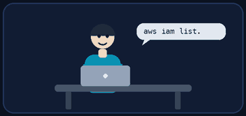
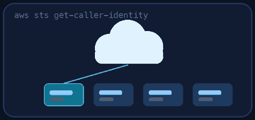
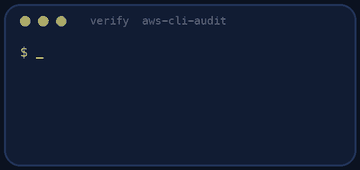
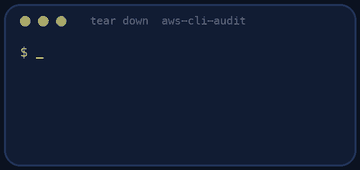

<p align="center"></p>

| | |
|-|-|
| **Time** | 75-90 min |
| **Cost** | free |
| **You need** | An AWS account with an administrator user (from the IAM lab), the AWS CLI v2 and Python 3 |

## How this lab works

1. **Fork** this repository to your own GitHub account (button at the top right).
2. Clone **your fork** in your Ubuntu environment (WSL on Windows, your OrbStack machine on Mac).
3. Read the lab below (the same text is in [`LAB.md`](LAB.md)) and follow the mission.
4. Answer the questions in [`SUBMISSION.md`](SUBMISSION.md). Where a question asks for output, paste it in a code block. No screenshots needed.
5. Commit and push. Open the **Actions** tab of your fork (click *I understand my workflows, go ahead and enable them* the first time). The **Lab check** shows what is still missing.
6. When the check is green, **submit the URL of your fork** in the course platform.

> [!NOTE]
> The check only looks at your answers and any files the lab asks you to commit. Your instructor reads your work and may ask you to explain any line.

<p align="center"></p>

## 🎬 The situation

<p align="center"></p>

Tuesday, 16:00. The investors' due-diligence team sends a list of questions about the AWS account that Clippy runs on. They need the answers by tomorrow morning:

*"Who can log in? Is anyone without MFA? What is running, and where? Are any storage buckets exposed to the internet?"*

You could open forty console pages and take screenshots. You could also write a script that answers all four questions in two seconds, today, and next quarter, and for the next company you work at. That script is the real deliverable of this lab, and writing it is how you learn the AWS CLI.

> [!IMPORTANT]
> **Your mission**
> - Install and configure the AWS CLI v2 with a **named profile**
> - Learn the CLI's output formats, `--query` (JMESPath), pagination and `--dry-run`
> - Write `audit.sh`: an account inventory report in a fixed format
> - Handle the failure every real audit script meets: an API call that **errors** for some resources
> - Do one of the same calls in Python with **boto3**

**Time:** 75-90 min | **Cost:** free (read-only calls) | **You need:** an AWS account with the admin user from the IAM lab, AWS CLI v2, Python 3. The tests use a **practice mode**, so you can finish the scripting part even without the account.

<p align="center"></p>

## Part 0 - Set the scene

Fork this repository and clone your fork in your Ubuntu environment. Install the CLI v2 (the official instructions are at `docs.aws.amazon.com/cli/latest/userguide/getting-started-install.html`). Then check:

```bash
aws --version
```

You will also need an access key for a **practice** IAM user with administrator access. In the console create the user `cli-admin` (IAM -> Users), attach `AdministratorAccess`, and under **Security credentials** create an access key for the "Command Line Interface" use case. You will delete this key at the end of the lab.

<p align="center"></p>

## Part 1 - Recon: who am I?

<p align="center"></p>

```bash
aws configure --profile clippy
aws sts get-caller-identity --profile clippy
```

1. Open `~/.aws/credentials` and `~/.aws/config`. What goes in each file? Which of the two should never be shared?
2. What does `get-caller-identity` return? Compare the `Arn` with the user in the console.
3. Run `aws sts get-caller-identity` **without** the profile. What happens? Then run `export AWS_PROFILE=clippy` and again. Finally try with `AWS_ACCESS_KEY_ID=bad`. Which credentials won each time?

> [!NOTE]
> **Predict** The CLI looks for credentials in a fixed order: command-line flags, environment variables, config files, then container or instance roles. In which order do you think? Check the documentation page "Configuration and credential file settings" and compare.

> [!NOTE]
> **Think** A long-lived access key on your laptop is a secret that does not expire. What happens if the laptop is stolen, or the key is pasted into a public repository? Name two alternatives you could use instead (hint: IAM Identity Center / `aws sso login`, and roles with `aws sts assume-role`).

<p align="center"></p>

## Part 2 - Learn the CLI's language

Try each, read the result, and change it:

```bash
aws ec2 describe-regions --output table --profile clippy
aws ec2 describe-regions --output text --query 'Regions[].RegionName' --profile clippy
aws iam list-users --query 'Users[].[UserName,CreateDate]' --output table --profile clippy
aws s3api list-buckets --query 'Buckets[?starts_with(Name, `clippy`)].Name' --profile clippy
AMI=$(aws ssm get-parameter --name /aws/service/ami-amazon-linux-latest/al2023-ami-kernel-default-x86_64 --region eu-west-1 --query Parameter.Value --output text --profile clippy)
aws ec2 run-instances --dry-run --image-id "$AMI" --instance-type t3.micro --region eu-west-1 --profile clippy
```

1. What does `--query` do, and why is it better than piping JSON into `grep`? Write the JMESPath for "the names of all buckets whose name contains `finance`".
2. Compare `--output json`, `table` and `text`. Which one would you feed into a shell `for` loop and why? Which one is dangerous when a value can contain spaces or tabs?
3. What does `--dry-run` do on the `run-instances` call above? The first line fetches the ID of the latest Amazon Linux AMI from a public SSM parameter (a handy trick). Read the error carefully: it is called `DryRunOperation`. Does it mean the call would have worked or failed? Now repeat the call with a made-up ID like `ami-12345678`: which error do you get instead, and what does that teach you about the order in which AWS checks things?
4. A command like `aws s3api list-objects-v2 --bucket x` returns at most 1000 items. How does the CLI handle more (pagination)? Look for `--max-items`, `--page-size` and `--no-paginate`.

<p align="center"></p>

## Part 3 - Build audit.sh

`./audit.sh [PROFILE]` prints **exactly** this format (alphabetical, one fact per line):

```text
ACCOUNT 111122223333
CALLER arn:aws:iam::111122223333:user/cli-admin
REGIONS_ENABLED 6
RUNNING_INSTANCES eu-west-1 2
RUNNING_INSTANCES us-east-1 1
BUCKET clippy-assets BLOCK_PUBLIC_ACCESS no
BUCKET clippy-finance BLOCK_PUBLIC_ACCESS yes
BUCKET clippy-uploads BLOCK_PUBLIC_ACCESS yes
BUCKET old-demo-site BLOCK_PUBLIC_ACCESS no
USERS_WITHOUT_MFA priya,sam-intern
```

Rules:

- `ACCOUNT` and `CALLER` come from `sts get-caller-identity`.
- `REGIONS_ENABLED` is the number of regions from `ec2 describe-regions`.
- `RUNNING_INSTANCES region count` appears **only for regions with at least one running instance**, in region-name order. (Loop over regions; use `--filters Name=instance-state-name,Values=running`.)
- `BUCKET name BLOCK_PUBLIC_ACCESS yes|no`, sorted by bucket name. It is `yes` only if all four settings of `s3api get-public-access-block` are `True`. A bucket with **no configuration at all** makes that command fail with an error: report it as `no`, do not crash.
- `USERS_WITHOUT_MFA` lists, alphabetically and comma-separated, the IAM users with no MFA device (`iam list-mfa-devices`), or the word `none`.
- An optional argument is the profile name; without it, use the default credentials.
- Start with `set -euo pipefail`. Use `--query` to select data; do not parse JSON with `grep` or `sed`.

Build it one fact at a time and run it often. In an account with many Regions and buckets the real run can take a minute or two, because it makes one call per Region, bucket and user. That is normal; the Level up section shows how to speed it up.

> [!WARNING]
> **Break it** Run it against a bucket you create in your own account **without** a Block Public Access configuration (name it `clippy-audit-test-<your initials>`, S3 console -> bucket -> Permissions -> untick, only while testing, and delete it afterwards), or read what `set -e` does when `get-public-access-block` returns exit code 254. What does your script do the first time it meets that error? Make it survive, and write a sentence on why "no configuration" is itself a finding.

### Practice mode (no AWS needed)

`./verify.sh` runs your script against a **fake** `aws` in `tests/bin/` with two made-up accounts, one of them with an unconfigured bucket. You can run your script the same way yourself:

```bash
PATH="$PWD/tests/bin:$PATH" ./audit.sh
```

It needs `python3-jmespath` (`sudo apt install python3-jmespath`). The expected output for the first fake account is in `tests/expected-account1.txt`.

<p align="center"></p>

## Part 4 - The real thing

Run `./audit.sh clippy` against your own account. Compare the output with what you know. Anything you did not expect? An old bucket, a region with a forgotten instance, a user without MFA (hello, `sam-intern`)? Keep the output for your submission.

<p align="center"></p>

## Part 5 - The same question in Python (boto3)

Write `whoami.py` with `boto3`: create an `sts` client, call `get_caller_identity()` and print the account and ARN. Install with `pip install boto3` (or `sudo apt install python3-boto3`). Run it with `AWS_PROFILE=clippy python3 whoami.py`.

> [!NOTE]
> **Think** boto3 found your credentials without you writing them in the script. Where did it look? What would you have to change to run the same script in GitHub Actions or on an EC2 instance, with no access keys at all?

<p align="center"></p>

## Part 6 - Prove it, then close the door

<p align="center"></p>

```bash
./verify.sh
```

Finally, **deactivate and delete the access key** you created for `cli-admin` (IAM -> Users -> cli-admin -> Security credentials), then delete the user if you do not need it. A key that was only needed for a lab should not outlive the lab.

<p align="center"></p>

## Level up (optional)

- **Speed.** Run the per-Region calls in parallel with `xargs -P 8` or background jobs and `wait`. How much faster is it, and what must you be careful about with the output order?
- **JSON report.** Add `--json` to `audit.sh` and emit the report as a JSON object. Use `jq`.
- **Multi-account.** Loop over several profiles and print one report per account.
- **CloudShell.** Open AWS CloudShell from the console and run `audit.sh` there. Which credentials does it use, and why is no `aws configure` needed?

<!-- teardown:start (generated by labs.py, do not edit) -->
## Tear down (mandatory)

<p align="center"></p>

Resources left behind cost money, keep doors open and pollute the next lab. Removing what you created is part of the job, so it is part of the submission: **you must prove it is gone**.

Do this **last**, after you have pasted your `verify` output into `SUBMISSION.md` (once you tear down, the lab can no longer be verified).

1. Delete the access key of `cli-admin` in the console (IAM -> Users -> cli-admin -> Security credentials), then delete the user if you do not need it. If you created a test bucket, name it `clippy-audit-test-<initials>` and delete it.
2. Remove the `[clippy]` profile from `~/.aws/credentials` and `[profile clippy]` from `~/.aws/config`, and `unset AWS_PROFILE AWS_ACCESS_KEY_ID AWS_SECRET_ACCESS_KEY` in your shell.
3. Run the check with your **normal admin** credentials (default profile, SSO or CloudShell), not with the profile you just deleted.

Then run the proof:

```bash
./teardown-check.sh
```

It prints a list of checks and must end with **TEARDOWN VERIFIED**. If it reports leftovers, remove them and run it again. Paste the full output in your submission.
<!-- teardown:end -->

<!-- submission:start (generated by labs.py, do not edit) -->
## 📬 Submission

Answer the questions in `SUBMISSION.md` in **your fork** (paste output in code blocks where asked), push, then submit the **URL of your fork**.

**Files to commit**

- `audit.sh` and `whoami.py`: your two scripts, committed to the repo

**Questions to answer**

1. Paste the output of `aws sts get-caller-identity` for your configured profile. Which credentials is the CLI using and in which order does it look for them (flags, environment, profile, instance role)?
2. Paste the report `./audit.sh` produced against your real account. Did it find anything that surprised you?
3. `aws s3api get-public-access-block` fails with an error for a bucket that has no configuration. What happened to your script when it hit that bucket, and what did you do about it? Why is a missing configuration a finding?
4. Show one `--query` expression you wrote and explain it piece by piece. When would you use `--output text` instead of JSON, and what is the risk?
5. Why should long-lived access keys on a laptop worry a security team? Name two alternatives the CLI supports and when each fits.
6. Paste the output of `./verify.sh`. It must end with **ALL CHECKS PASSED**.
7. **Tear down.** Paste the output of `./teardown-check.sh`. It must end with **TEARDOWN VERIFIED**.
<!-- submission:end -->
